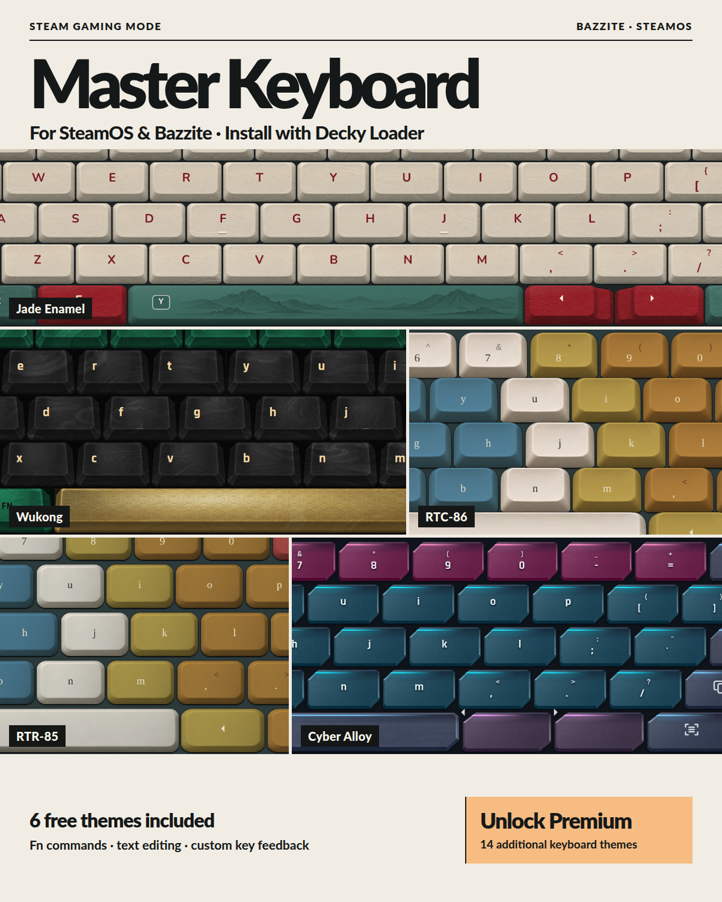
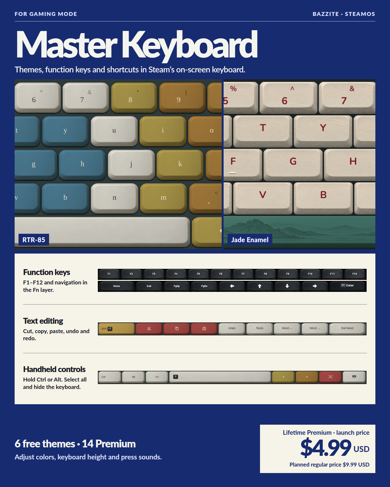

# Master Keyboard for Bazzite and SteamOS

Master Keyboard redesigns Steam’s on-screen keyboard for **Bazzite and SteamOS Gaming Mode**. The Decky Loader plugin adds function keys, text editing shortcuts, controller feedback and customizable keyboard themes for handheld play.

[**Download the latest release for Decky Loader**](https://github.com/soullegacyvn-ux/Master-Keyboard/releases/latest)

## What’s inside

- **Fn and navigation.** Reach F1–F12, Escape, Home, End, Page Up, Page Down and the four arrow keys from the on-screen keyboard.
- **Text editing.** Select all, cut, copy, paste, undo and redo with dedicated buttons. Tap Ctrl or Alt to hold it for a shortcut.
- **Visible controller feedback.** A filled focus color shows your selected key. Pressed and held keys sink and darken.
- **Custom appearance and sound.** Adjust the keyboard height, theme colors, background opacity, focus color and typing sound.

## Install on Bazzite or SteamOS

### 1. Set up Decky Loader

If Decky is already installed, skip to the next section.

- **Bazzite** — Switch to Desktop Mode, open a terminal, and run `ujust setup-decky`. Follow the installer and return to Gaming Mode. [Bazzite Decky setup guide](https://docs.bazzite.gg/Handheld_and_HTPC_edition/Handheld_Wiki/)
- **SteamOS** — Switch to Desktop Mode and download the official Decky installer. Move `decky_installer.desktop` to your desktop, open it, and choose **Latest Release** when prompted. Then select **Return to Gaming Mode**. [Decky Loader installation guide](https://github.com/SteamDeckHomebrew/decky-loader#-installation)

### 2. Install Master Keyboard

#### From Decky's Custom Store

1. In Gaming Mode, open the Quick Access Menu (**…**) and select the **Decky** plug icon.
2. Open **Settings → General → Store Channel** and select **Custom**. Enter `https://master-keyboard-decky-store.soullegacyvn.workers.dev/plugins` as the Store URL.
3. Open Decky's Store and install **Master Keyboard**. Decky checks this catalog for updates while the Custom channel is selected.

#### From a ZIP

1. In Desktop Mode, download the Master Keyboard install ZIP from [GitHub Releases](https://github.com/soullegacyvn-ux/Master-Keyboard/releases/latest) to **Downloads** and leave it zipped.
2. Return to Gaming Mode. Open the Quick Access Menu (**…**) and select the **Decky** plug icon.
3. Select the **Settings** gear. Under **General**, turn on **Developer mode**.
4. Open **Developer**, choose **Install Plugin from ZIP File**, select the downloaded ZIP, and confirm the installation.

After installation, open **Master Keyboard** in Decky, turn on **Enabled**, and select one of the six Free themes. Open Steam’s on-screen keyboard to try it.

If you use another Steam keyboard theme in CSS Loader, disable it before enabling Master Keyboard.

## Free and Premium themes

The plugin includes **six Free themes** and previews of **14 Premium themes**. Open **Master Keyboard** in Decky to view the one-time price and pay with PayPal. Premium unlocks automatically after payment confirmation and works offline after activation. Use **Restore purchase** and your receipt email to recover access or transfer activation to a new installation.

## Feedback

To report an issue, include your handheld model, OS, Steam client channel, Decky version and the selected theme.

Master Keyboard’s interface and theme designs are copyright Vincent. Bundled third-party assets and dependencies retain their respective licenses. See `assets/ASSET-SOURCES.txt` inside the install ZIP.
