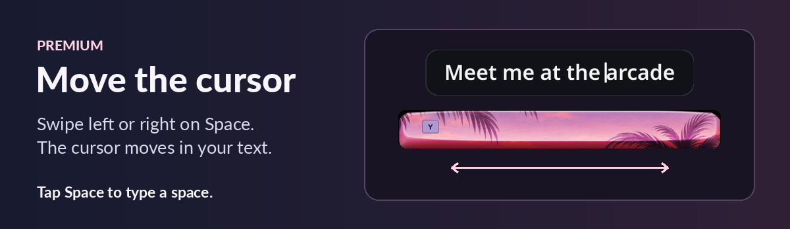
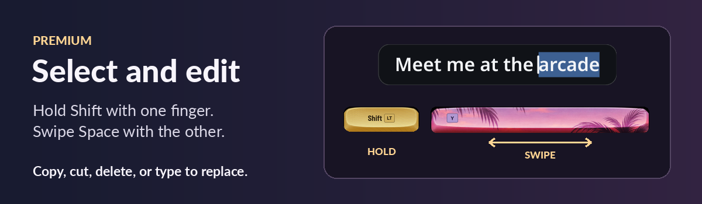
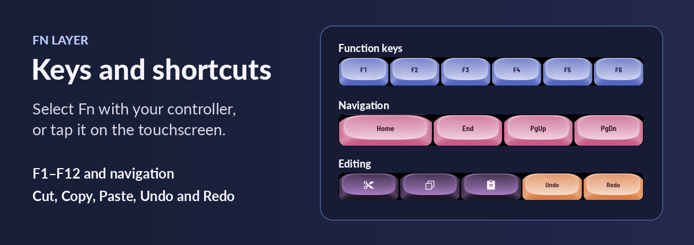

# Master Keyboard for Bazzite and SteamOS

Master Keyboard redesigns Steam’s on-screen keyboard for **Bazzite and SteamOS Gaming Mode**. The Decky Loader plugin adds function keys, text editing shortcuts, controller feedback and customizable keyboard themes for handheld play.

[**Download the latest release for Decky Loader**](https://github.com/soullegacyvn-ux/Master-Keyboard/releases/latest)
· [See the keyboard in use](#see-the-keyboard-in-use)

## What’s inside

- **Fn and navigation.** Reach F1–F12, Escape, Home, End, Page Up, Page Down and the four arrow keys from the on-screen keyboard.
- **Text editing.** Select all, cut, copy, paste, undo and redo with dedicated buttons. Tap Ctrl or Alt to hold it for a shortcut.
- **Typing preview.** See the text you’re typing above the keyboard. Premium adds gestures for moving the cursor and selecting text.
- **Visible controller feedback.** A filled focus color shows your selected key. Pressed and held keys sink and darken.
- **Custom appearance and sound.** Adjust the keyboard height, theme colors, background opacity, focus color and typing sound.

## See the keyboard in use

### Space gestures · Premium

In Gaming Mode, open **Decky → Master Keyboard → Layout & sound** and turn on **Typing preview**. This enables both gestures on **v1.2.11 or later** with Premium active. The **Preview on/off** button at the upper left of the keyboard also controls whether the gestures are available.

### Fn and editing shortcuts

Tap **Fn** to reveal **F1–F12**, navigation and editing commands. **Copy** and **Paste** are also available on the main layout.

## Install on Bazzite or SteamOS

### 1. Set up Decky Loader

If Decky is already installed, skip to the next section.

- **Bazzite** — Switch to Desktop Mode, open a terminal, and run `ujust setup-decky`. Follow the installer and return to Gaming Mode. [Bazzite Decky setup guide](https://docs.bazzite.gg/Handheld_and_HTPC_edition/Handheld_Wiki/)
- **SteamOS** — Switch to Desktop Mode and download the official Decky installer. Move `decky_installer.desktop` to your desktop, open it, and choose **Latest Release** when prompted. Then select **Return to Gaming Mode**. [Decky Loader installation guide](https://github.com/SteamDeckHomebrew/decky-loader#-installation)

### 2. Install Master Keyboard

#### From Decky's Custom Store

1. In Gaming Mode, open the Quick Access Menu (**…**) and select the **Decky** plug icon.
2. Open **Settings → General → Store Channel** and select **Custom**. Enter `https://master-keyboard-decky-store.soullegacyvn.workers.dev/plugins` as the Store URL.
3. Open Decky's Store and install **Master Keyboard**. Decky checks this catalog for updates while the Custom channel is selected.

#### From a ZIP

1. In Desktop Mode, download the Master Keyboard install ZIP from [GitHub Releases](https://github.com/soullegacyvn-ux/Master-Keyboard/releases/latest) to **Downloads** and leave it zipped.
2. Return to Gaming Mode. Open the Quick Access Menu (**…**) and select the **Decky** plug icon.
3. Select the **Settings** gear. Under **General**, turn on **Developer mode**.
4. Open **Developer**, choose **Install Plugin from ZIP File**, select the downloaded ZIP, and confirm the installation.

After installation, open **Master Keyboard** in Decky, turn on **Enabled**, and select one of the six Free themes. Open Steam’s on-screen keyboard to try it.

### Update Master Keyboard

On **v1.2.0 or later**, open **Decky → Master Keyboard → Check for updates**. When a release is available, choose **Install update** and confirm in Decky.

For versions before v1.2.0, install the latest ZIP over your current copy or update through the Master Keyboard Custom Store above. Your saved settings carry over.

If you use another Steam keyboard theme in CSS Loader, disable it before enabling Master Keyboard.

## Themes

Master Keyboard includes six ready-to-use themes and previews of fourteen additional styles.

## Source and verification

The Decky client source, dependency lockfile, and third-party notices are here. See [Build and verify](BUILD.md) for instructions to reproduce the frontend and review what the plugin accesses.

## Feedback

To report an issue, include your handheld model, OS, Steam client channel, Decky version and the selected theme.

Master Keyboard’s interface and theme designs are copyright Vincent. Bundled third-party assets and dependencies retain their respective licenses. See `assets/ASSET-SOURCES.txt` inside the install ZIP.
